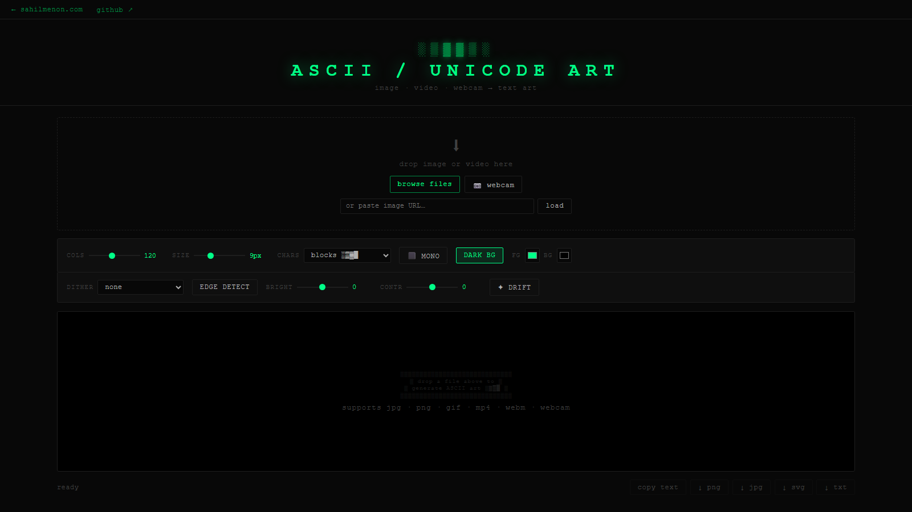

# ASCII / Unicode Art Converter

[](https://github.com/sahilmenon/Unicode-Art-Converter/actions/workflows/ci.yml) [](LICENSE)

A zero-dependency, fully client-side image / video / webcam → ASCII/Unicode art converter that sustains **30 fps video at ~2.1 ms/frame** in the browser. ~1,700 lines of Astro + vanilla JavaScript — no server, no frameworks, nothing leaves your machine.

**Live demo:** [sahilmenon.com/projects/ascii](https://sahilmenon.com/projects/ascii)



## At a glance

| | |
|---|---|
| Real-time video | **30 fps at ~2.1 ms/frame** (measured in-app at 1920×1080) |
| Emoji matching | **O(1)** nearest-colour lookup via a precomputed **32³ = 32,768-entry** RGB quantisation table |
| Unicode pool | **3,163 codepoints** density-sorted across 18 Unicode blocks |
| Emoji mosaic | **123 emoji**, colour-sampled at runtime from the local emoji font |
| Character modes | 7 (blocks, dense/simple ASCII, Braille, Unicode, emoji, custom) |
| Input sources | 4 — file, clipboard paste, URL, live webcam |
| Export formats | 6 — copy text, PNG, JPG, SVG, TXT, WebM recording |
| Footprint | ~1,700 lines, zero runtime dependencies, single page |

## Features

**Input**
- Drag & drop or browse for images and videos
- Paste from clipboard
- Live webcam feed
- Load from URL

**Character modes**
- Block characters `░▒▓█`
- Dense ASCII (69 levels)
- Simple ASCII
- Braille patterns `⣿` (2×4 dot cells)
- Unicode — 3,163 codepoints density-sorted across 18 Unicode blocks
- Emoji mosaic — nearest-color emoji matched via the O(1) lookup table
- Custom — type your own character sequence (sparse → dense)

**Effects**
- Full-color or monochrome with custom fg/bg color pickers
- Invert (dark bg / light bg)
- Brightness and contrast sliders
- Dithering — Floyd-Steinberg, Atkinson, Ordered/Bayer
- Edge detection — Sobel operator → directional chars `─ │ ╱ ╲`
- Drift mode — particle flow along iso-luminance contours

**Export**
- Copy as plain text
- Download PNG, JPG, SVG, TXT
- Webcam snapshot (freezes frame, then export as above)
- Record video as WebM (live canvas capture)

## How the fast path works

- An offscreen sampler canvas downscales each frame to the output grid, so per-cell colour reads are one `getImageData` pass.
- Emoji mode quantises each cell's RGB to 5 bits per channel and indexes the precomputed 32,768-entry table — no per-frame distance search.
- Rendering batches through a single `requestAnimationFrame` loop; the in-app status bar reports live render time per frame.

## Tech stack

- [Astro](https://astro.build) — static site, single page, zero JS frameworks
- Canvas API — offscreen sampler canvas + output canvas, `requestAnimationFrame` loop
- `MediaRecorder` API — video recording
- Cloudflare Pages — hosting

## Local development

```bash
npm install
npm run dev
```

## Build & deploy

```bash
npm run build   # outputs to dist/
```

**Cloudflare Pages settings:**
- Build command: `npm run build`
- Build output directory: `dist`
- Node version: 18+

## License

MIT
